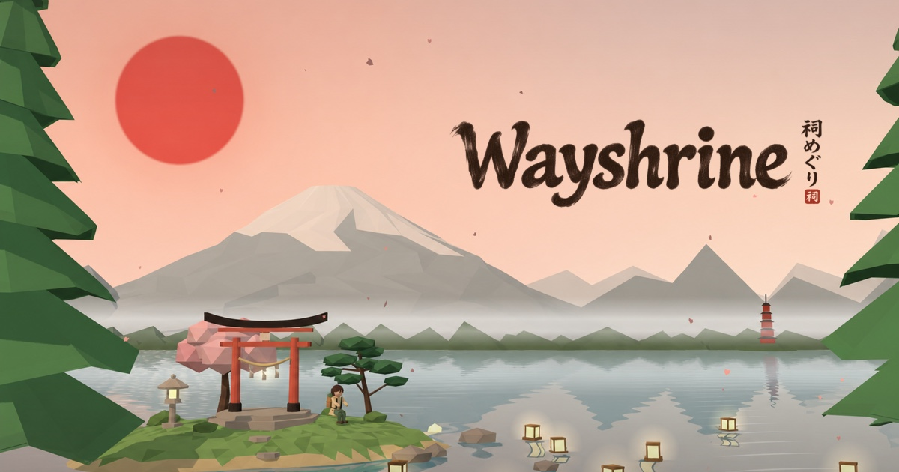

<p align="center">
  
</p>

<p align="center">
  <b>A quiet exploration game inspired by Japan.</b><br>
  Restore forgotten shrines, bring the land back to life, and visit the country's most famous places.
</p>

<p align="center">
  <a href="https://wayshrine.app"><b>▶ Play free in your browser at wayshrine.app</b></a>
</p>



## About

You wake in a grey, sleeping land. Every region has a shrine at its heart, and when you restore one, colour and life spread outward across the hills, rivers and villages around it. Play for five minutes or five hours, and the world goes on as far as you care to walk.

Along the way you find Japan's landmarks — Fushimi Inari, Himeji Castle, Mt Fuji and dozens more — each waiting to be woken. Restoring them earns the gear that opens the rest of the world.

- **66 hand-built landmarks** from across Japan, from Hokkaido's drift ice to Okinawa's coral islands.
- **An endless, hand-tuned procedural world.** Every seed is a new journey.
- **Gear that changes how you travel:** unlock the ability to cross different types of terrain.
- **A thousand inscriptions to collect.** Haiku, proverbs, and idioms, carved on stones that become legible once the land is restored.
- **A travel journal and map** to look back on where you've been and return to any restored shrine.
- **Listen to a calming soundtrack** that inspires you to explore the unknown.
- **Play in English or Japanese**, with a keyboard, a controller, or touch.

## How to play

Walk up to a shrine or landmark and restore it. Restored landmarks earn stars, and star milestones unlock new gear.

| | Keyboard and mouse | Controller | Touch |
| --- | --- | --- | --- |
| Move | WASD or arrow keys | Left stick or D-pad | Drag on the left side of the screen |
| Restore, read, board, skip | E, Space or Enter | A | Action button |
| Map | M | View | Map button |
| Overhead view | Z | Stick click | Overview button |
| Journal | J | Y | Journal button |
| Backpack | I | X | Backpack button |
| Rubbing box | B | Right trigger | Box button |
| Turn pages | ← → | LB / RB | Page arrows |
| Back / Options | Esc | B / Menu | Close / gear button |

The full list is under **Options → Controls** in the game.

**Requirements:** a recent version of Chrome, Edge, Firefox or Safari with WebGL. Phones and tablets play in landscape. Your journey saves automatically in the browser's local storage on that device.

## Credits

Created by Jeffrey Wang using Claude and Codex.

- Proverbs and idioms from JMdict/EDICT, © the Electronic Dictionary Research and Development Group, CC BY-SA 4.0.
- Haiku by Matsuo Bashō, Yosa Buson and Kobayashi Issa.
- Lettering: Yuji Syuku, Kaushan Script and Cormorant Garamond (SIL Open Font License 1.1).
- Music and sound effects generated with ElevenLabs.
- Built with [three.js](https://threejs.org).

---

## Development

Wayshrine is Three.js + TypeScript + Vite. It runs in the browser and as an Electron desktop app.

Use Node.js 24.

```
npm ci
npm run dev        # http://localhost:5173
npm run check      # typecheck + tests + production build; run before pushing
```

- `?seed=anything` picks the world; `?debug` adds a debug panel.
- After editing anything in `content/`, run `npm run content` to regenerate the texts (a test fails if they're stale).
- Landmark models are generated by Blender scripts in `content/landmarks/`; see [docs/landmarks.md](docs/landmarks.md).

| You want to… | Read |
| --- | --- |
| Understand the game and its design intent | [docs/DESIGN.md](docs/DESIGN.md) |
| Understand how the code is organised, and add to it | [docs/ARCHITECTURE.md](docs/ARCHITECTURE.md) |
| Know why a choice was made | [docs/decisions/](docs/decisions/) |
| See what is built and what is next | [docs/ROADMAP.md](docs/ROADMAP.md) |
| Work on the code with an AI agent | [CLAUDE.md](CLAUDE.md) |

Full index: [docs/README.md](docs/README.md).

### Web release (GitHub Pages)

The **Web release** workflow (`.github/workflows/pages.yml`) runs `npm run check` and publishes `dist/` to GitHub Pages on every push to `main`, or on demand from the Actions tab. It builds with `VITE_SITE_URL=https://wayshrine.app/`, which sets the canonical URL and the social preview image. Assets use relative paths, so the same build also works from a subdirectory.

To build the web version locally, run `VITE_SITE_URL=https://wayshrine.app/ npm run build` and serve `dist/` (for example with `npm run preview`).

### Desktop builds

See [Steam release setup](docs/steam.md) for Steam Cloud and achievements.

Toggle fullscreen in **Options** or with **F11**. **Quit game** is on the title screen and in the in-game settings, and saves your journey.

Run `npm ci`, then `npm run desktop:package` on your platform. The build goes in `release/`. The **Desktop release** workflow also builds both platforms on demand and on `v*` tags.

| Platform | Bundle | Steam launch option |
| --- | --- | --- |
| Windows x64 | `Wayshrine-win32-x64/` | `Wayshrine.exe` |
| macOS (Apple silicon and Intel) | `Wayshrine-darwin-universal/` | `Wayshrine.app` |

Download the workflow's ZIP artifacts, then upload the unpacked contents of each bundle folder to its own [SteamPipe depot](https://partner.steamgames.com/doc/sdk/uploading). Steam installs the whole folder. Progress and preferences are stored in the desktop app's own profile.

The macOS workflow produces ad hoc signed builds for testing. To build for release, install a Developer ID Application certificate and create a `notarytool` keychain profile on a Mac. Set `WAYSHRINE_MAC_SIGN_IDENTITY` to that certificate name and `WAYSHRINE_MAC_NOTARY_PROFILE` to the profile name before running `npm run desktop:package -- mac`. See [macOS signing and notarization](https://www.electronforge.io/guides/code-signing/code-signing-macos).

## License

Code: [Apache License 2.0](LICENSE). The collection of Japanese texts shown on the monuments is separate and licensed CC BY-SA 4.0; see [content/LICENSE.md](content/LICENSE.md). Fonts are under the SIL Open Font License 1.1; see [NOTICE](NOTICE).
